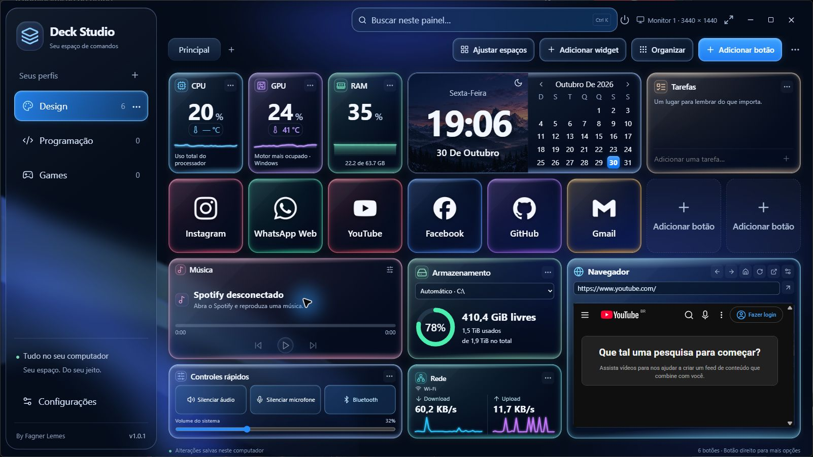
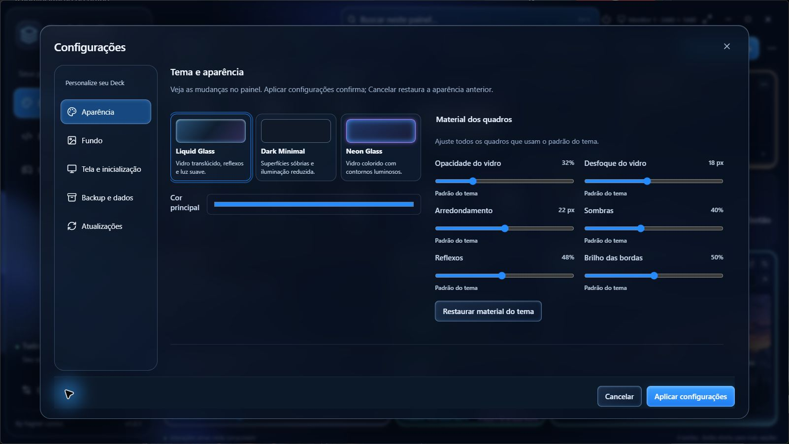

# Deck Studio

Seu espaço de comandos para Windows. **By Fagner Lemes.**

Painel personalizável com perfis, atalhos, widgets de CPU/GPU, armazenamento, rede, música, controles rápidos e mini navegador.

*Painel da versão 1.0.1, com dois espaços livres para novos botões. Captura do aplicativo Windows em uma sessão de demonstração.*

## Personalize seu Deck

Escolha entre Liquid Glass, Dark Minimal e Neon Glass. Ajuste transparência, desfoque, arredondamento, sombras, reflexos e brilho das bordas, além do fundo e da iluminação.

## Downloads oficiais

- [Versão mais recente](https://github.com/fagnerlemes/DeckStudio/releases/latest)
- [Histórico de versões](https://github.com/fagnerlemes/DeckStudio/releases)

Baixe o arquivo `DeckStudio-<versão>-x64-setup.exe` nos anexos da release. Os arquivos chamados “Source code”, gerados pelo GitHub, contêm a documentação deste repositório e não são o instalador.

## Atualizar pelo programa

Na versão 1.0.0, abra **Configurações → Atualizações → Verificar atualizações**. A consulta é manual; não ocorre automaticamente na abertura. Havendo uma versão estável mais nova, escolha **Baixar atualização** e depois **Instalar e reiniciar**.

O aplicativo confere a assinatura e a versão do pacote antes de instalar. Perfis, atalhos, imagens, preferências e dados locais do navegador são preservados. Encerre ou conclua a edição do painel antes de atualizar.

## Sensores

O leitor integrado contempla processadores Intel/AMD e GPUs NVIDIA/AMD/Intel, conforme suporte do hardware e permissões. Alguns sensores exigem o driver PawnIO e autorização local. Não é necessário manter TURZX, HWiNFO ou Libre Hardware Monitor aberto. Um sensor indisponível aparece sem leitura.

## Integridade e suporte

Cada versão inclui hashes SHA-256 e avisos/licenças de terceiros. A assinatura `.sig` é usada pelo atualizador; não é um certificado Authenticode do Windows.

Relate problemas nas [Issues](https://github.com/fagnerlemes/DeckStudio/issues), informando versão do Deck, versão do Windows, modelo da CPU/GPU e passos para reproduzir. Evite anexar backups pessoais ou dados de login.

Este é o repositório público de distribuição. Os instaladores estão em Releases; o código-fonte proprietário e as chaves privadas de assinatura não são publicados aqui.
