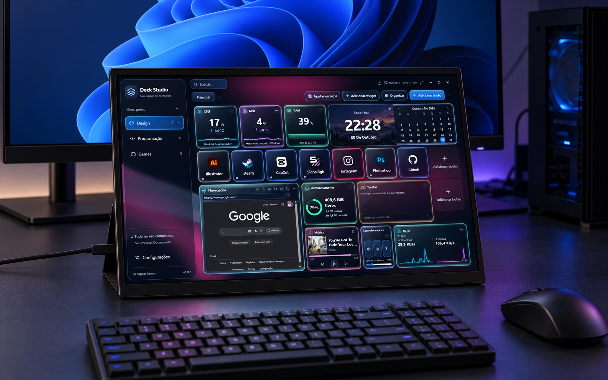
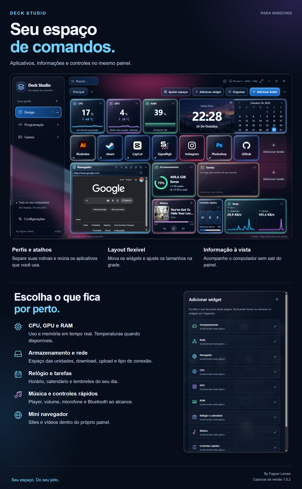
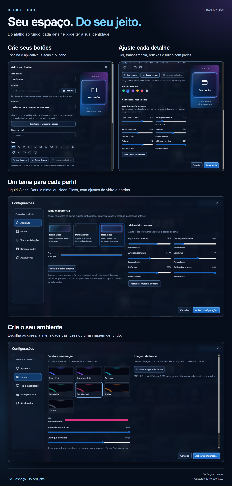

# Deck Studio

Seu espaço de comandos para Windows. **By Fagner Lemes.**

Aplicativos, informações do computador e controles do dia a dia em um painel personalizável.

[Patch Atual 1.0.2](https://github.com/fagnerlemes/DeckStudio/releases/tag/v1.0.2) · [Baixar versão oficial](https://github.com/fagnerlemes/DeckStudio/releases/latest) · [Histórico de versões](https://github.com/fagnerlemes/DeckStudio/releases) · [Relatar um problema](https://github.com/fagnerlemes/DeckStudio/issues)

## Deck Studio na sua segunda tela

*Mockup ilustrativo de uso em uma tela portátil de 15,6″. A disposição do equipamento é uma simulação.*

## Conheça o painel

As imagens desta apresentação usam capturas da **versão 1.0.2**, fornecidas pelo autor. Clique nas imagens para ampliar. Os pacotes publicados estão em [Releases](https://github.com/fagnerlemes/DeckStudio/releases).

| Parte do painel | O que você pode fazer |
| --- | --- |
| Perfis e páginas | Separar rotinas, aplicativos e layouts. Criar, renomear e duplicar perfis. |
| Botões | Abrir aplicativos e destinos, escolher ícones e definir o comportamento ao clicar. |
| Organização | Arrastar widgets, ajustar tamanhos na grade e organizar os espaços do painel. |
| CPU, GPU e RAM | Acompanhar uso e memória; ver temperaturas quando o hardware e as permissões permitem. |
| Armazenamento | Ver espaço livre e usado e escolher a unidade nas opções do widget. |
| Rede | Acompanhar download, upload e a conexão por Wi-Fi ou cabo. |
| Relógio e tarefas | Consultar horário, data e calendário e manter lembretes no painel. |
| Música | Ver a mídia identificada, a capa quando disponível e os controles de reprodução. |
| Controles rápidos | Ajustar volume, silenciar áudio ou microfone e controlar Bluetooth. |
| Mini navegador | Abrir sites e vídeos dentro do painel e recolher os controles para ampliar o conteúdo. |

## Personalize seu Deck

- **Criação de botões:** escolha o destino, a ação, o nome e o ícone. Use a imagem do aplicativo, pesquise ícones ou envie uma imagem.
- **Aparência individual:** personalize a cor e o material de um botão ou widget, com prévia.
- **Tema do perfil:** escolha Liquid Glass, Dark Minimal ou Neon Glass. Ajuste opacidade, desfoque, arredondamento, sombras, reflexos e brilho.
- **Fundo e iluminação:** use uma das paletas, escolha uma cor ou adicione sua imagem de fundo.
- **Tela e inicialização:** escolha em qual monitor o painel deve abrir.
- **Backup e dados:** exporte e restaure perfis, páginas, atalhos, widgets e imagens. Logins do navegador e programas instalados permanecem no computador.

<strong>Ver os seis prints individualmente</strong>

Os recortes abaixo preservam a interface dos prints enviados. Nas janelas abertas, as laterais desfocadas foram retiradas para dar destaque aos controles.

| Captura | Detalhes |
| --- | --- |
| [Painel completo](docs/images/painel-1.0.2.png) | Perfis, atalhos e widgets em uso. |
| [Adicionar widget](docs/images/widgets-1.0.2.png) | Catálogo de widgets para compor a página. |
| [Criar botão](docs/images/criar-botao-1.0.2.png) | Aplicativo, destino, ação, nome e ícone. |
| [Aparência do botão](docs/images/vidro-botao-1.0.2.png) | Prévia, cor, transparência, desfoque, bordas e reflexos. |
| [Tema e aparência](docs/images/aparencia-1.0.2.png) | Temas e material padrão dos quadros do perfil. |
| [Fundo e iluminação](docs/images/fundo-1.0.2.png) | Paletas, intensidade, desfoque e imagem de fundo. |

## Downloads oficiais

- [Patch Atual 1.0.2](https://github.com/fagnerlemes/DeckStudio/releases/tag/v1.0.2) — cumulativo para a 1.0.2 original ou com Fixes 1–6. Inclui fundos CSS ajustáveis e todas as melhorias anteriores. **Aplicação manual; requer 1.0.2 instalada.** Não é instalador completo nem atualização da 1.0.1.
- [Versão mais recente](https://github.com/fagnerlemes/DeckStudio/releases/latest)
- [Histórico de versões](https://github.com/fagnerlemes/DeckStudio/releases)

Baixe o arquivo `DeckStudio-<versão>-x64-setup.exe` nos anexos da release. Os arquivos chamados “Source code”, gerados pelo GitHub, contêm a documentação deste repositório e não são o instalador.

## Atualizar pelo programa

Na versão 1.0.0, abra **Configurações → Atualizações → Verificar atualizações**. A consulta é manual; não ocorre automaticamente na abertura. Havendo uma versão estável mais nova, escolha **Baixar atualização** e depois **Instalar e reiniciar**.

O aplicativo confere a assinatura e a versão do pacote antes de instalar. Perfis, atalhos, imagens, preferências e dados locais do navegador são preservados. Encerre ou conclua a edição do painel antes de atualizar.

## Sensores

O leitor integrado contempla processadores Intel/AMD e GPUs NVIDIA/AMD/Intel, conforme suporte do hardware e permissões. Alguns sensores exigem o driver PawnIO e autorização local. Não é necessário manter TURZX, HWiNFO ou Libre Hardware Monitor aberto. Um sensor indisponível aparece sem leitura.

## Integridade e suporte

Cada versão inclui hashes SHA-256 e avisos/licenças de terceiros. A assinatura `.sig` é usada pelo atualizador; não é um certificado Authenticode do Windows.

Relate problemas nas [Issues](https://github.com/fagnerlemes/DeckStudio/issues), informando versão do Deck, versão do Windows, modelo da CPU/GPU e passos para reproduzir. Evite anexar backups pessoais ou dados de login.

Este é o repositório público de distribuição. Os instaladores estão em Releases; o código-fonte proprietário e as chaves privadas de assinatura não são publicados aqui.
