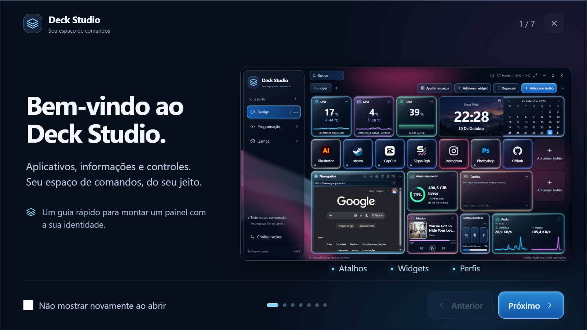
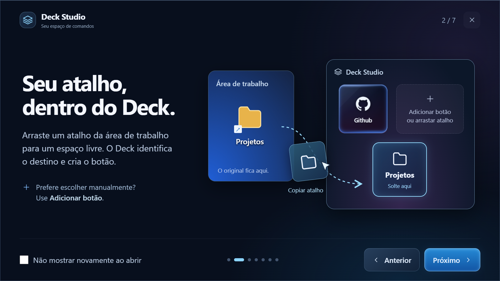
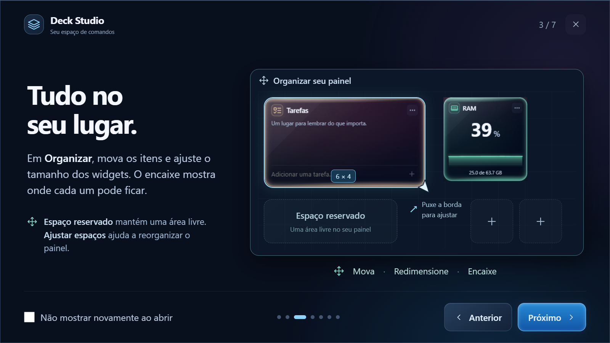
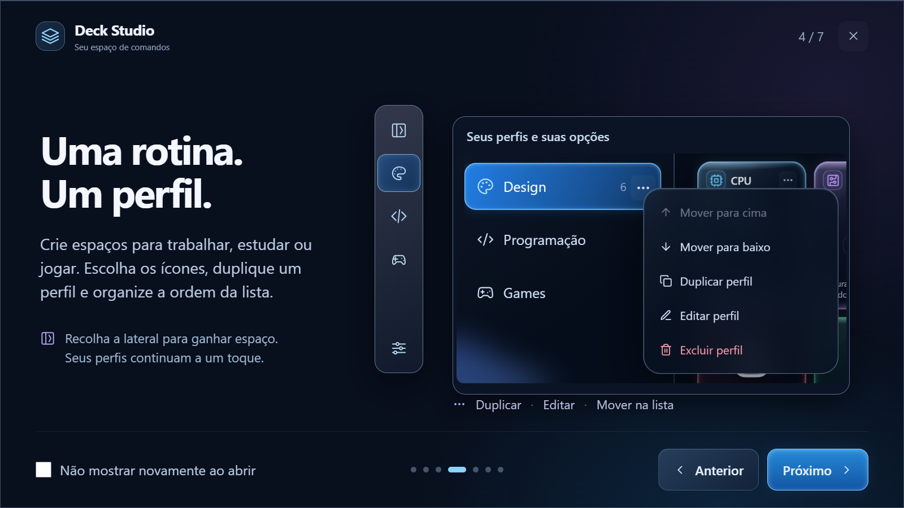
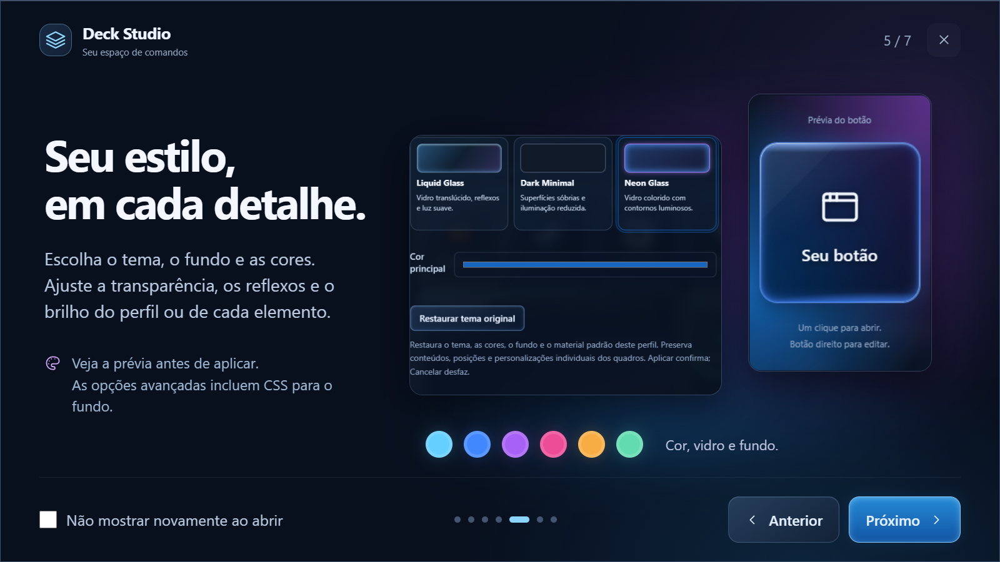
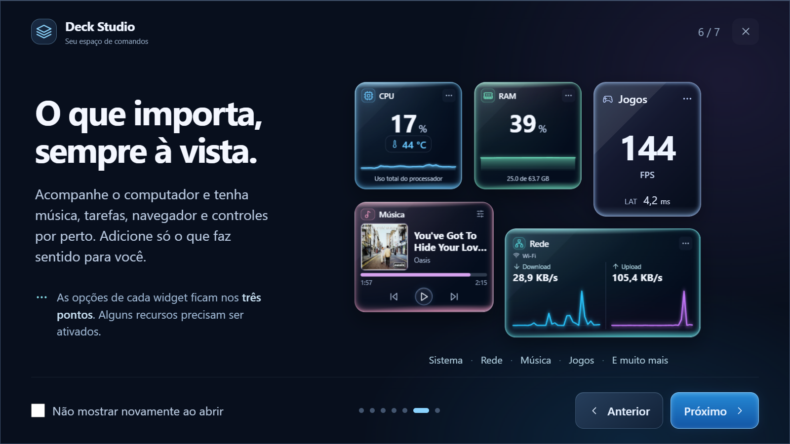
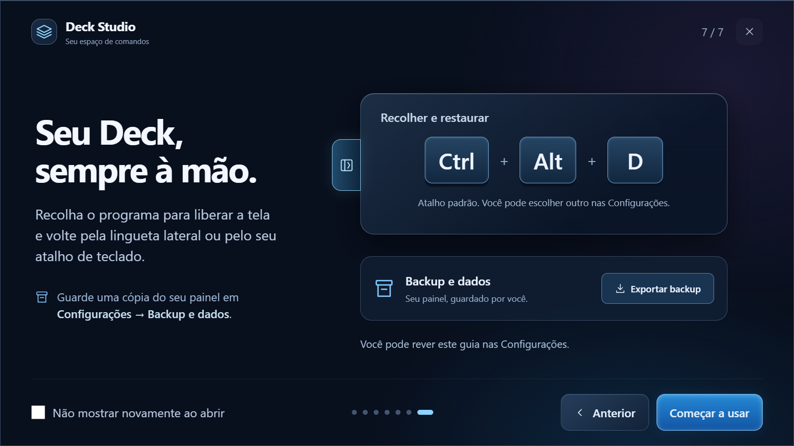

# Deck Studio

Seu espaço de comandos para Windows. **By Fagner Lemes.**

Aplicativos, pastas, informações do computador e controles do dia a dia em um painel personalizável.

**Versão atual: 1.1.3** — reúne o conteúdo da 1.1.0 com o Patch Fix 3, agora com numeração própria.

[Baixar instalador completo](https://github.com/fagnerlemes/DeckStudio/releases/download/v1.1.3/DeckStudio-1.1.3-x64-setup.exe) · [Baixar patch](https://github.com/fagnerlemes/DeckStudio/releases/download/v1.1.3/DeckStudio-1.1.3-Patch-x64.exe) · [Histórico de atualizações](CHANGELOG.md)

## Qual arquivo baixar?

| Pacote | Quando usar |
| --- | --- |
| **Instalador completo 1.1.3** | Primeira instalação ou atualização de qualquer versão anterior. Não precisa desinstalar. |
| **Patch 1.1.3** | Atualização menor para quem tem **1.1.0 Fix 2 ou Fix 3**. A base é conferida antes de alterar arquivos. |

Conclua ou cancele edições abertas antes de atualizar. Perfis, botões, widgets, layouts, configurações e dados locais do navegador são preservados. O patch fecha e reabre o Deck se ele estiver em execução.

## Guia rápido

As sete telas abaixo são do guia disponível no programa. Clique em uma imagem para ampliar. Você pode rever o carrossel em **Configurações → Guia rápido** ou marcar **Não mostrar novamente ao abrir**.

### 1. Seu espaço de comandos

### 2. Arraste um atalho para o Deck

O Deck identifica o destino e cria o botão. Você também pode usar **Adicionar botão** para escolher um aplicativo, arquivo ou pasta.

### 3. Organize o painel

Em **Organizar**, ajuste os tamanhos e posições. Um widget novo que ficar fora da área precisa ser encaixado ou ter a inclusão cancelada antes de concluir.

### 4. Crie perfis para suas rotinas

Recolher a lateral libera espaço para o painel. Ao reabrir, o menu aparece sobre os itens, sem reorganizá-los.

### 5. Personalize cada detalhe

Escolha temas e fundos em CSS, altere cores ou use sua imagem. A aparência também pode ser ajustada individualmente em botões e widgets.

### 6. Escolha seus widgets

CPU, GPU, RAM, armazenamento, rede, relógio, tarefas, música, controles rápidos, navegador, Pastas, Jogos, Iluminação e Espaço reservado. **Pastas** oferece busca, navegação, lista com data de modificação quando há espaço e ícones grandes.

Temperaturas dependem do suporte do hardware e das permissões locais. Iluminação requer SignalRGB compatível. O widget Jogos usa um coletor de desempenho; sua LAT é a medida de apresentação até conclusão na GPU e pode diferir da exibida pelo Alt+R da NVIDIA.

### 7. Recolha, restaure e faça backup

**Ctrl + Alt + D** é o atalho padrão, alterável nas Configurações. A lingueta lateral também traz o Deck de volta. Exporte uma cópia do seu painel em **Configurações → Backup e dados**.

## Atualizar pelo programa

Abra **Configurações → Atualizações → Verificar atualizações**. A consulta é manual. Quando houver uma versão mais nova, escolha **Baixar atualização** e **Instalar e reiniciar**. O atualizador usa o instalador completo e verifica sua assinatura.

## Downloads, integridade e suporte

A [Release atual](https://github.com/fagnerlemes/DeckStudio/releases/latest) reúne o instalador completo e o patch. Os demais anexos são a assinatura, o manifesto do atualizador, hashes, instruções e licenças. A assinatura `.sig` pertence ao atualizador; não é um certificado Authenticode do Windows. Os arquivos “Source code” gerados pelo GitHub contêm a documentação pública, não o código do aplicativo.

As mudanças anteriores estão reunidas em [um único histórico](CHANGELOG.md). Relate problemas nas [Issues](https://github.com/fagnerlemes/DeckStudio/issues), com a versão e os passos para reproduzir.

Este repositório é destinado à distribuição e documentação. O código-fonte proprietário, as chaves de assinatura e os dados pessoais não são publicados aqui.
